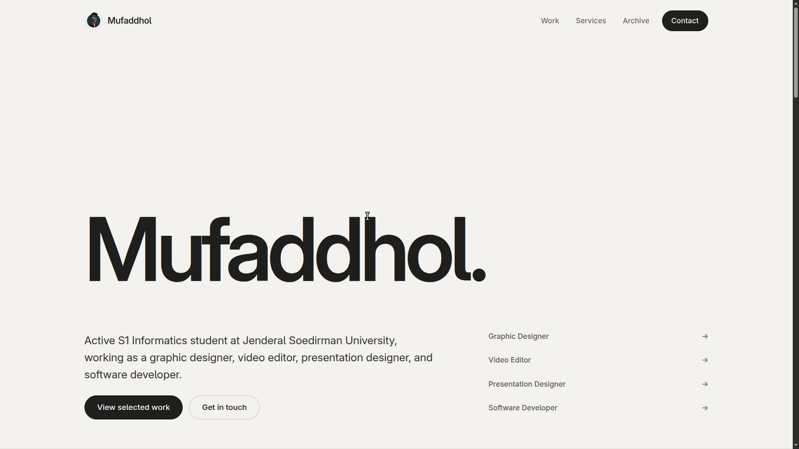
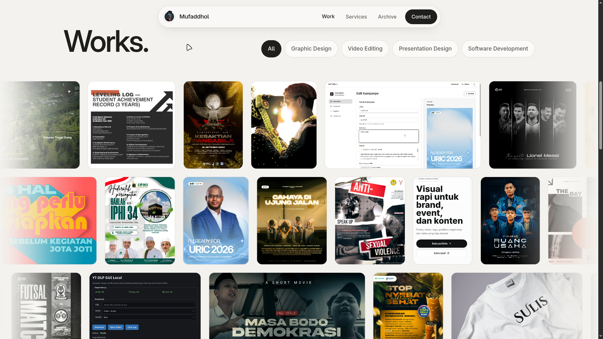
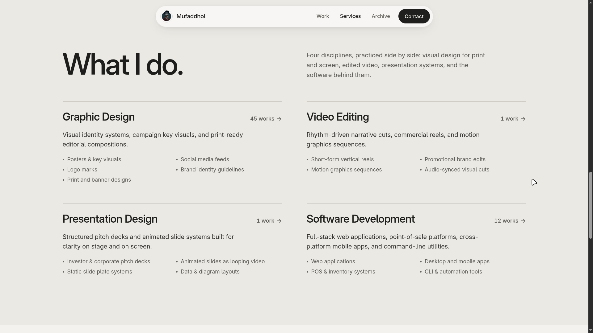
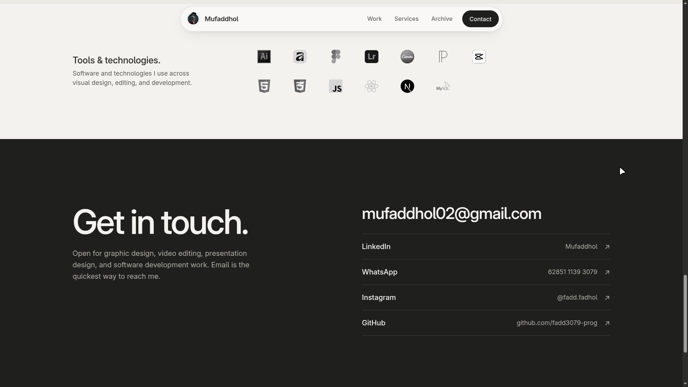
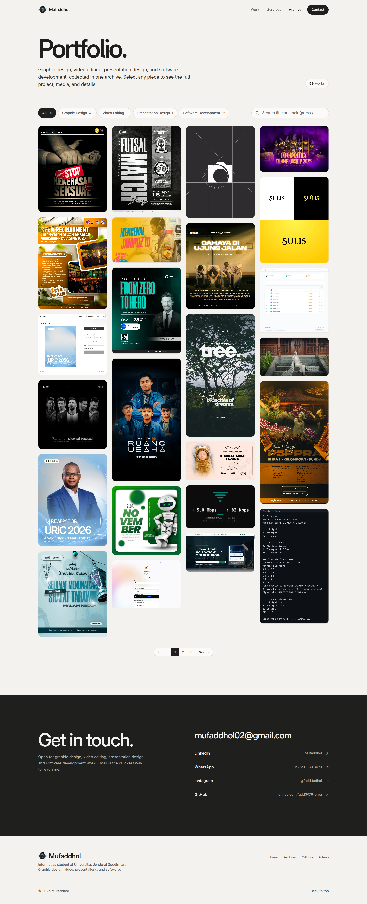
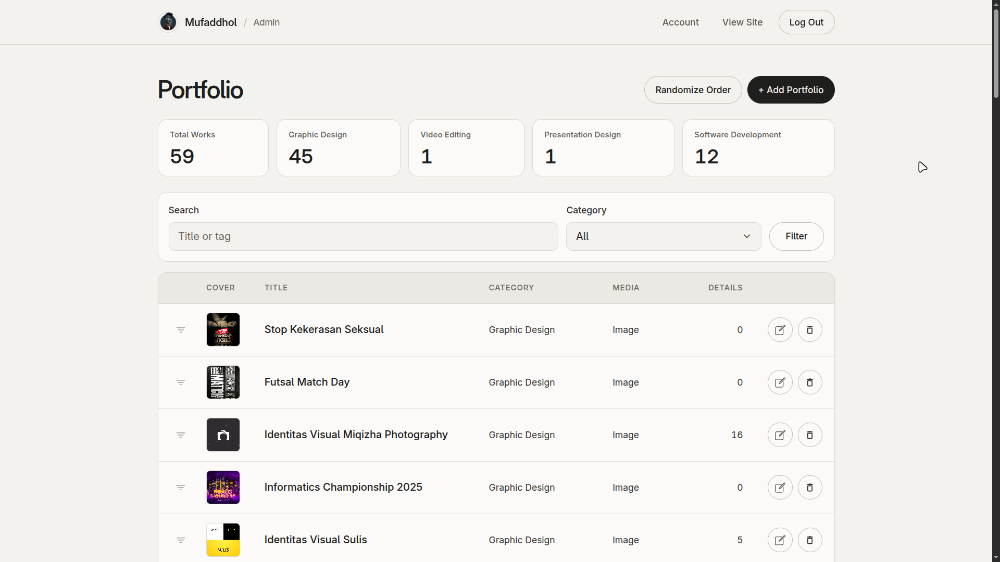
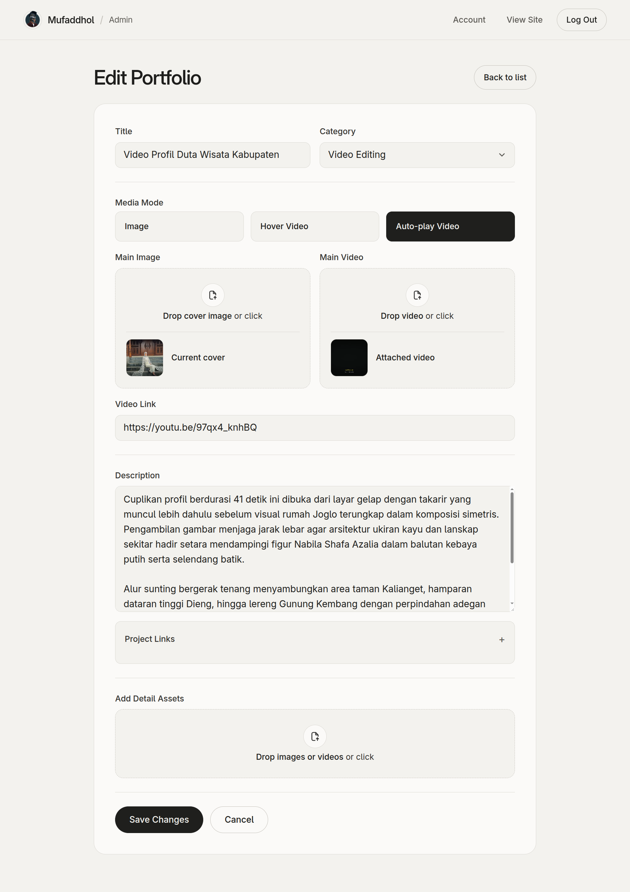

# Portfolio Website Mufaddhol



Aplikasi web portofolio pribadi yang dibangun menggunakan PHP 8 native, MySQL/MariaDB (PDO), HTML5, CSS3, dan JavaScript vanilla tanpa framework. Proyek ini dikembangkan untuk memenuhi tugas mata kuliah **Pemrograman Web I** sekaligus mengelola publikasi karya lintas empat bidang: desain grafis, penyuntingan video, desain presentasi, dan pengembangan perangkat lunak.

---

## Informasi Akademik & Tautan

| Keterangan | Detail |
|---|---|
| Mata Kuliah | Pemrograman Web I |
| Dosen Pengampu | Agus Darmawan, S.Kom., M.Cs (`NIP 199008172024061001`) |
| Mahasiswa | Mufaddhol (`H1D025069`) |
| Live Demo | [https://mufaddhol.site.je/](https://mufaddhol.site.je/) |
| Repository GitHub | [https://github.com/fadd3079-prog/Mufaddhol.git](https://github.com/fadd3079-prog/Mufaddhol.git) |

### Akses Demo Admin (Mode Viewer)

Untuk meninjau halaman manajemen admin tanpa risiko mengubah data produksi, silakan masuk menggunakan akun demo ber-role `viewer` (`read-only`):

| URL Login | Username | Password | Hak Akses |
|---|---|---|---|
| [https://mufaddhol.site.je/admin/login.php](https://mufaddhol.site.je/admin/login.php) | `admindemo` | `admindemo` | Melihat daftar portofolio, menyaring kategori/pencarian, dan membuka pratinjau form tambah karya (`POST`, edit, urut ulang, dan hapus dinonaktifkan) |

---

## Fitur Utama

### Halaman Publik

- `index.php` (Beranda) menampilkan bagian hero, *marquee* tiga baris beranimasi dengan *object pooling* dan *lazy video lifecycle*, filter kategori langsung, ringkasan empat disiplin kerja, daftar alat dan teknologi, serta tautan kontak.
- `portfolio.php` (Arsip Portofolio) menyajikan grid *masonry* tervirtualisasi dengan tinggi kartu mengikuti rasio aspek asli gambar (`aspect_ratio`), filter kategori, penyaring *tech stack*, pencarian cepat melalui pintasan `/`, serta paginasi server 24 item per halaman (`?page=N`).
- `detail.php` (Halaman Detail) memuat media utama (gambar dengan *lightbox zoom*, video lokal, atau embed YouTube, Vimeo, Google Drive, TikTok, dan Instagram), deskripsi dari parser Markdown native, *tech tags*, tautan demo/GitHub, navigasi karya sebelumnya dan berikutnya, serta galeri aset tambahan.

### Panel Admin (`admin/`)

- `admin/login.php` dan `admin/account.php` menangani autentikasi berbasis sesi dengan `password_verify()`, pembatasan percobaan gagal pada tabel `login_attempts`, rotasi ID sesi dan token CSRF saat login, *idle timeout* 30 menit, serta pemisahan hak akses `admin` dan `viewer`.
- `admin/index.php` dan `admin/form.php` mendukung operasi tambah, ubah, dan hapus data portofolio beserta lampiran galeri dalam transaksi PDO, penyimpanan otomatis draf form di `sessionStorage` dan `IndexedDB`, pengurutan ulang baris via drag-and-drop maupun tombol `Randomize Order`, serta pembersihan berkas media lama di disk.

---

## Keamanan & Optimasi Performa

Seluruh kueri SQL memakai *prepared statement* PDO (`ATTR_EMULATE_PREPARES = false`) dan keluaran HTML disanitasi melalui `htmlspecialchars()`. Setiap aksi mutasi di panel admin divalidasi dengan token CSRF `hash_equals()`, sedangkan berkas unggahan diperiksa tipe MIME aslinya lewat `finfo` dan dibatasi ukurannya (5 MB untuk gambar, 10 MB untuk video). Respons HTTP mengirimkan header `Content-Security-Policy`, `X-Frame-Options`, `X-Content-Type-Options`, `Referrer-Policy`, dan `Permissions-Policy`.

Pada tingkat server, berkas `.htaccess` memblokir akses langsung ke direktori `database/`, `config/`, berkas `.sql`, cadangan `.bak-*`, dan skrip di dalam `assets/uploads/` tanpa memakai direktif `Options` agar tetap berjalan di shared hosting InfinityFree.

Untuk menjaga waktu muat halaman tetap ringan, rasio aspek aset galeri disimpan langsung pada kolom `portfolio_details.aspect_ratio` sehingga halaman depan tidak melakukan pembacaan dimensi berulang ke disk. Kompresi gzip dan caching aset statis jangka panjang dikonfigurasi lewat `.htaccess`, halaman publik memakai `Cache-Control: public, max-age=3600`, dan pemutaran video otomatis pada *marquee* maupun arsip dibatasi maksimal tiga video aktif sekaligus dengan `preload="metadata"`.

---

## Tangkapan Layar Antarmuka

### Halaman Publik

| Bagian Karya (*Works Marquee*) | Ringkasan Layanan (*What I Do*) |
|---|---|
|  |  |

| Alat, Teknologi, & Kontak | Arsip Portofolio (*Masonry* & Paginasi) |
|---|---|
|  |  |

### Panel Admin & Editor CRUD

| Dashboard Admin (`admin/index.php`) | Form Editor Portofolio (`admin/form.php`) |
|---|---|
|  |  |

---

## Struktur Proyek

```text
Mufaddhol/
├── .htaccess                  # Proteksi direktori sensitif, kompresi gzip, & header cache
├── .gitignore                 # Mengecualikan media unggahan dan konfigurasi lokal
├── index.php                  # Beranda (hero, marquee karya, layanan, alat, kontak)
├── portfolio.php              # Arsip portofolio dengan masonry, filter, & paginasi
├── detail.php                 # Halaman detail karya, renderer Markdown, & galeri
├── admin/
│   ├── _layout.php            # Template header/footer admin & header keamanan no-store
│   ├── login.php              # Autentikasi admin/viewer dengan rate limiting
│   ├── logout.php             # Penghancuran sesi via POST + CSRF
│   ├── index.php              # Daftar karya, pencarian, urut ulang, acak urutan, & hapus
│   ├── form.php               # Tambah/ubah karya, upload media, & aset galeri
│   └── account.php            # Pengaturan username & kebijakan password minimal 12 karakter
├── config/
│   ├── database.php           # Koneksi PDO (env var -> database.local.php -> default lokal)
│   ├── database.example.php   # Templat konfigurasi database lokal/produksi
│   ├── helpers.php            # Helper sesi, keamanan, CSRF, Markdown, upload, & kartu
│   └── layout.php             # Layout halaman publik, navigasi, footer, & lightbox
├── database/
│   ├── schema.sql             # Skema lengkap basis data (users, portfolios, details, login_attempts)
│   └── migrations/            # Skrip migrasi bertahap
└── assets/
    ├── css/                   # tokens.css, main.css, admin.css
    ├── js/                    # portfolio-engine.js & admin-form.js
    ├── fonts/                 # Bundled Adwaita Sans Variable
    ├── icons/                 # Ikon SVG lokal
    ├── screenshot/            # Tangkapan layar dokumentasi README
    └── uploads/               # Penyimpanan media covers/, details/, & videos/
```

---

## Instalasi Lokal (XAMPP / Apache + MySQL)

1. Klon repositori ini ke folder webroot (misalnya `/opt/lampp/htdocs/Mufaddhol` atau `C:\xampp\htdocs\Mufaddhol`):
   ```bash
   git clone https://github.com/fadd3079-prog/Mufaddhol.git Mufaddhol
   cd Mufaddhol
   ```
2. Impor skema basis data [database/schema.sql](database/schema.sql) ke MySQL/MariaDB melalui phpMyAdmin atau CLI:
   ```bash
   mysql -u root < database/schema.sql
   ```
3. Salin [config/database.example.php](config/database.example.php) menjadi `config/database.local.php` (atau atur environment variable `MUFADDHOL_DB_*`), lalu sesuaikan host, nama database, username, dan password MySQL Anda.
4. Pastikan modul Apache `mod_rewrite`, `mod_headers`, dan `mod_deflate` aktif, serta direktori `assets/uploads/{covers,details,videos}` dapat ditulisi oleh server web.
5. Buat user admin atau viewer pertama di tabel `users` menggunakan hash `password_hash(..., PASSWORD_DEFAULT)` dari PHP sebelum membuka halaman `admin/login.php`.
